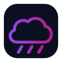

# Nimbus Weather

**Weather states, climate transitions, time-of-day modifiers, hazards, and environment events.**

Nimbus Weather is a first-party Helios module isolated behind the shared module contract so games can enable, replace, or extend this subsystem independently.

## Contract

- Module id: `nimbus-weather`
- Category: `weather`
- State namespace: `world.modules.nimbus-weather`
- Integration: event-driven and capability-safe

## Status

Experimental 0.x reference module.
