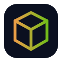

# Vault Inventory

**Items, containers, equipment slots, stack rules, ownership, transfers, loot, and inventories.**

Vault Inventory is a first-party Helios module isolated behind the shared module contract so games can enable, replace, or extend this subsystem independently.

## Contract

- Module id: `vault-inventory`
- Category: `inventory`
- State namespace: `world.modules.vault-inventory`
- Integration: event-driven and capability-safe

## Status

Experimental 0.x reference module.
